# AI Workflow

A Codex-only Plugin that runs one software feature through pinned Matt Pocock-derived engineering methods, Project Contract safety, GitHub specification and tickets, two-agent implementation and quality, and explicitly approved pull-request delivery.

## Workflow

```mermaid
flowchart LR
    P["Repository setup preflight"] --> C["Project Contract"]
    C --> W["Workspace Gate"]
    W --> G["$grill-with-docs"]
    G --> S["$to-spec"]
    S -->|"Specification Gate"| PI["GitHub parent issue"]
    PI --> T["$to-tickets"]
    T -->|"Ticket Breakdown Gate"| TI["GitHub sub-issues"]
    TI --> I["Implementation Agent"]
    TI --> Q["Quality Agent"]
    I --> R["Ticket verify + $code-review"]
    Q --> R
    R -->|"passed"| K["Controller ticket commit"]
    R -->|"owned findings"| I
    K -->|"more tickets"| I
    K -->|"all tickets"| CR["Configuration reconciliation"]
    CR -->|"configuration-reconciled"| F["Feature verify + review"]
    CR -->|"owned findings"| I
    F --> D["Delivery Gate"]
    D --> PR["Push + pull request"]
```



The public controller is `$ai-workflow`. The methods remain independently invokable:

```text
$setup-matt-pocock-skills
$grill-with-docs
$grilling
$domain-modeling
$to-spec
$to-tickets
$implement
$tdd
$code-review
```

`$grilling` interviews one decision at a time through a design tree. `$grill-with-docs` uses that interview together with `$domain-modeling` to record settled repository terms and decisions. During an `$ai-workflow` run, each reply identifies the active stage or Gate, progress, the pending decision or blocker, and the next step. Grill replies show the current question number, its prerequisite, and known queued decisions; the queue is recalculated after each answer.

`$triage`, GitLab, Linear, Jira, local-Markdown tracker execution, multi-ticket parallelism, automatic merge, and direct issue closure are outside this release.

## Install at USER scope

Ask the built-in installer to review and install the complete set from one commit:

```text
$skill-installer Install exactly these Skill paths from
https://github.com/pong1013/ai-workflow into my USER skill scope:

skills/ai-workflow
skills/code-review
skills/domain-modeling
skills/grill-with-docs
skills/grilling
skills/implement
skills/setup-matt-pocock-skills
skills/tdd
skills/to-spec
skills/to-tickets

Review and pin one source commit for the complete set first.
Review the Matt Pocock provenance and adaptations in UPSTREAM.md.
Do not modify the current repository.
Use one multi-path installer invocation with that pinned ref and a temporary
staging destination. Validate all 10 staged Skills before changing USER scope.
Preflight all 10 final destinations and stop before promotion if any exists.
If a legacy ship-feature Skill exists, move only that directory to a clearly
named recoverable backup outside the live USER skills directory (for example,
$CODEX_HOME/skill-backups/ship-feature-<timestamp>) after staging succeeds and
before promotion; stop if the backup target exists. Promote the complete staged
set. If promotion or final validation fails, remove only the newly promoted
paths from this attempt and restore the legacy directory from that backup.
Verify every installed file matches the reviewed source.
```

Installation makes the Skills available globally. It does not configure or modify the repository that happens to be open.

The legacy migration instruction is intentionally explicit: without it, the removed `$ship-feature` controller could remain discoverable beside `$ai-workflow`. The local runner exercises this staged, recoverable migration; installation from a public commit is still a separate release gate.

## Configure each repository once

In each repository, explicitly run:

```text
$setup-matt-pocock-skills
```

The setup Skill inspects remotes, repository instructions, domain docs, and ADRs; previews the preserved-content `.gitignore` rule for `.agents/setup/`, `docs/agents/issue-tracker.md`, `docs/agents/domain.md`, and bounded `AGENTS.md`/`CLAUDE.md` changes; then waits for confirmation before writing. The preview emits a plan token, and apply refuses any changed file set, content, option, or fetch/push remote until the new diff is approved. The ignore rule is part of that exact approved file set and is never written silently to `.git/info/exclude`. Setup asks Git in an isolated temporary repository, with relevant nested `.agents` ignore files mirrored, to verify the proposed `.gitignore` effectively ignores the receipt. A later root negation is repaired in the preview; an incompatible lower-level negation stops before any repository write. Apply repeats the check before writing. Setup validates and shows the diff but never commits or pushes.

A successful mutating apply writes an ignored `.agents/setup/receipt.json` for handoff to a later Codex task. Existing effective broader ignore rules such as `.agents/` are preserved; setup validation uses the same isolated Git check as preview and apply rather than requiring a literal `.agents/setup/` rule. The receipt records only the outputs changed by that apply, with `setup/configuration` provenance and path/hunk before-and-after hashes; unchanged managed outputs remain part of the approved plan and are re-rendered during validation. A no-op apply does not create or replace a receipt. Before handoff, validate the live repository and, when retaining the preview token, its exact approved plan:

```bash
python3 skills/setup-matt-pocock-skills/scripts/validate_setup_receipt.py . \
  --plan-token <approved-token>
```

The next `$ai-workflow` task validates the receipt against repository identity, current managed outputs, and the plan binding before importing its mutations into Feature Run reconciliation. A valid receipt is evidence of locally self-consistent setup output, not approval authority: it cannot publish an issue, authorize a ticket or commit, or replace a Gate. Its unkeyed checksum detects accidental corruption and non-self-consistent local edits. It is not a signature and does not authenticate evidence against a local actor who can rewrite both the receipt and checksum; that adversarial model requires an external trust anchor and is outside this release.

This release of `$ai-workflow` requires the resulting tracker configuration to select GitHub. A valid GitLab or Local Markdown setup remains truthful configuration, but `$ai-workflow` stops at the Exception Gate because those execution paths are unsupported. Jira, Linear, and other custom tracker configurations are not accepted by this release's setup contract.

## Run or resume

Start a new full Feature Run:

```text
$ai-workflow Add team invitations with expiring email links.
```

Stop or resume naturally:

```text
$ai-workflow Start this feature and stop after Grill.
$ai-workflow Continue from GitHub spec #123.
$ai-workflow Continue from the existing tickets for #123.
```

New features always pass through Grill, which may finish immediately when no consequential decision remains. Resume from a specification or tickets requires current approval provenance or a fresh Resume Gate.

For example, a Grill reply begins with `Stage: grill | Progress: workspace established | Pending: Q1 decision | Next: evaluate the answer`, followed by one decision question. A Gate reply names its Gate and shows the exact action awaiting approval. The question number indicates sequence, not a fixed total.

One Codex task owns one unfinished Feature Run. Run different features in different tasks and isolate their branches or worktrees when edits could overlap.

## Repository integration

The workflow reads:

- `docs/agents/issue-tracker.md` for tracker identity and operations;
- `docs/agents/domain.md` for domain-document layout;
- `.agents/project-contract.md` for verification, workspace, artifacts, and delivery;
- applicable `AGENTS.md`, `CLAUDE.md`, `CONTEXT.md`, `CONTEXT-MAP.md`, and ADRs.

If Matt setup is missing, `$ai-workflow` stops before creating a Feature Run. If the Project Contract is missing, it performs Contract Discovery and obtains approval before persistence.

GitHub stores the canonical parent specification and ticket sub-issues. Ignored `.agents/runs/<feature-id>.json` files store disposable local controller checkpoints, while ignored `.agents/setup/receipt.json` carries non-authoritative setup provenance across tasks. Losing either local artifact never restores or implies approval; an explicit GitHub parent issue can reconstruct work facts, but old approvals are not silently restored.

## Gates and delivery

Configuration reconciliation validates action-level provenance against the live Git diff before feature review. Canceled historical actions remain in the ledger and pass only with independently proven base/live restoration; equal endpoint hashes alone are insufficient. Delivery allows a clean index/worktree or exact unchanged baseline unrelated hunks disclosed in the existing Delivery Gate; that single approval also covers their continued presence. Deferred configuration requires an Exception-approved standalone GitHub follow-up, and a later run requires a new Workspace Gate after the originating PR merges. See the [complete configuration reconciliation guide](docs/configuration-reconciliation.md) for receipt and ledger schemas, routing, cancellation limits, trust boundaries, resume, and troubleshooting.

- **Setup Confirmation Gate:** authorizes only the displayed per-repository setup files.
- **Workspace Gate:** authorizes the displayed branch/worktree or ownership change.
- **Contract Persistence Gate:** authorizes only the displayed Project Contract.
- **Specification Gate:** approves and publishes one exact GitHub parent issue.
- **Ticket Breakdown Gate:** approves and publishes the exact ticket set and blocker graph.
- **Exception Gate:** resolves new consequential decisions, conflicts, missing capability, unsafe state, or a loop with no new evidence.
- **Delivery Gate:** authorizes only the displayed branch push and pull-request creation. Approval enters `delivery-approved`; the run becomes complete only after both operations succeed.

`$implement` never commits. After each ticket passes independent verification and review, the controller creates one local commit referencing the ticket. Issues stay open throughout local work and pull-request review; closing references take effect only when the pull request merges.

The controller keeps an ordered record of every ticket implementation/quality attempt and every feature verification/review attempt. Each round says what changed (or that nothing changed), which exact checks passed, failed, or were not applicable, the separate Standards and Spec review outcomes, and the next action. Failed rounds remain visible after retries. Stopping-point and final reports include the accumulated record, and the Delivery Gate shows the complete record before approval. Local checkpoints cache it but do not establish approval or substitute for current evidence.

## Implementation plan

The approved scope, sequence, acceptance criteria, and cross-repository rollout are in [Full Workflow v1 Implementation Plan](docs/plans/full-workflow-v1.md).

## Possible future improvements

- Evaluate whether a unified `$setup-ai-workflow` command materially simplifies per-repository onboarding. The current design already combines `$setup-matt-pocock-skills` with Project Contract discovery at runtime, so this is not a promised next-version feature.
- Evaluate a separate quick workflow only after the complete GitHub path is proven end to end.

## Development

```bash
python3 -m pip install --requirement requirements-dev.txt
make verify
make canonical-validate
```

`make verify` covers deterministic Plugin, Skill, provenance, state/authority, link, and negative-fixture checks. [Behavioral scenarios](evals/scenarios.md) and the [integration matrix](evals/integration-matrix.md) require fresh-task and external evidence; deterministic success alone never means the Plugin is release-ready.

## License and provenance

MIT licensed. See [UPSTREAM.md](UPSTREAM.md) and [THIRD_PARTY_NOTICES.md](THIRD_PARTY_NOTICES.md) for the pinned Matt Pocock sources, adaptations, and license notice.
